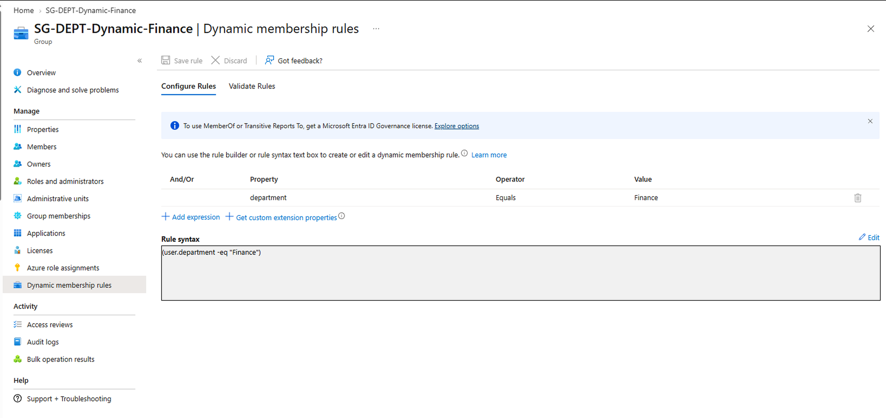
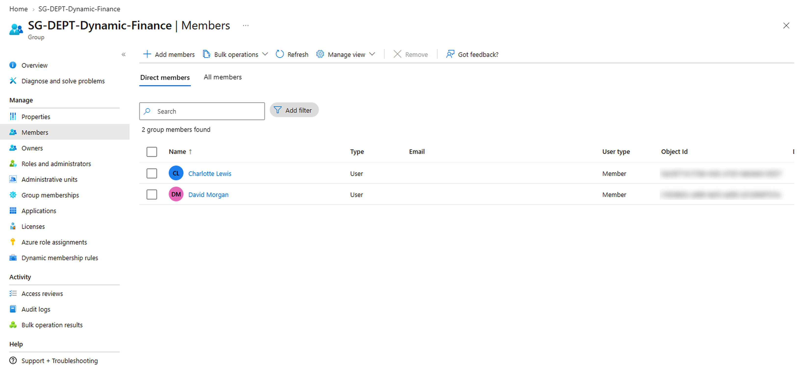

# LAB-004: Dynamic Group Management

## 1. Lab Overview

| Field | Details |
|---|---|
| Lab ID | LAB-004 |
| Title | Dynamic Group Management |
| SC-300 Skill Area | Implement and manage user identities |
| Organisation | Alenmac Consulting (fictional organisation) |
| Status | Completed |

## 2. Business Scenario

Alenmac Consulting wants to reduce the administrative effort involved in maintaining departmental group memberships.

Rather than manually adding employees to groups, the organisation wants Microsoft Entra ID to evaluate user attributes and automatically manage group membership.

## 3. Objectives

- Create a dynamic security group.
- Configure an attribute-based membership rule.
- Use the Department user attribute to determine group membership.
- Verify that matching employees are automatically included.
- Understand the difference between assigned and dynamic membership.

## 4. Implementation

### Step 1: Create the dynamic security group

Created a security group named:

`SG-DEPT-Dynamic-Finance`

Configured the membership type as **Dynamic User**.

### Step 2: Configure the membership rule

Configured the following dynamic membership rule:

`(user.department -eq "Finance")`

The rule evaluates the Department attribute on user accounts and includes users whose Department value equals Finance.

### Step 3: Verify dynamic membership

After the rule was processed, Microsoft Entra ID displayed two matching employees:

- Charlotte Lewis
- David Morgan

The group's overview also reported that dynamic rules processing had succeeded.

### Step 4: Confirm the result

Verified that the two Finance employees appeared in the group's membership list without manually adding them to the dynamic group.

## 5. Testing and Results

| Test | Expected Result | Outcome |
|---|---|---|
| Create dynamic security group | Group configured with Dynamic membership | Successful |
| Configure membership rule | Department equals Finance | Successful |
| Evaluate user attributes | Finance employees identified | Successful |
| Verify group membership | Charlotte Lewis and David Morgan included | Successful |
| Check rule processing | Dynamic rules processing succeeded | Successful |

## 6. Lessons Learned

- Dynamic groups automate membership management using user attributes.
- Accurate and consistent user profile attributes are essential for reliable rule evaluation.
- Assigned membership requires manual administration, whereas dynamic membership is evaluated automatically.
- Dynamic groups can reduce administrative overhead and support scalable identity management.
- Dynamic group processing must complete before membership results can be verified.

## 7. References

- [Microsoft Entra dynamic groups documentation](https://learn.microsoft.com/en-us/entra/identity/users/groups-dynamic-membership)
- [Dynamic membership rules for groups](https://learn.microsoft.com/en-us/entra/identity/users/groups-dynamic-membership#constructing-the-body-of-a-dynamic-membership-rule)

## 8. Evidence

### Dynamic Membership Rule

### Dynamic Group Members

