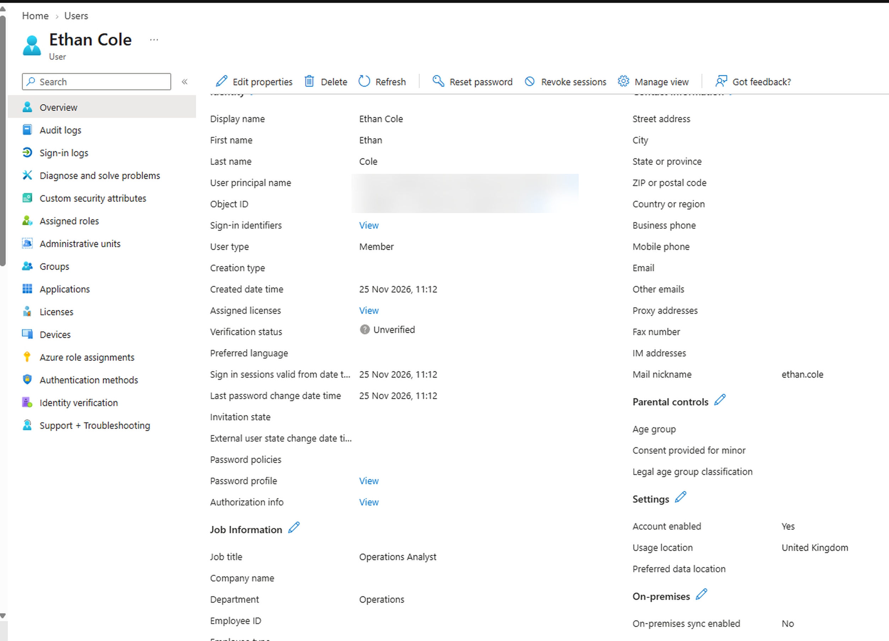
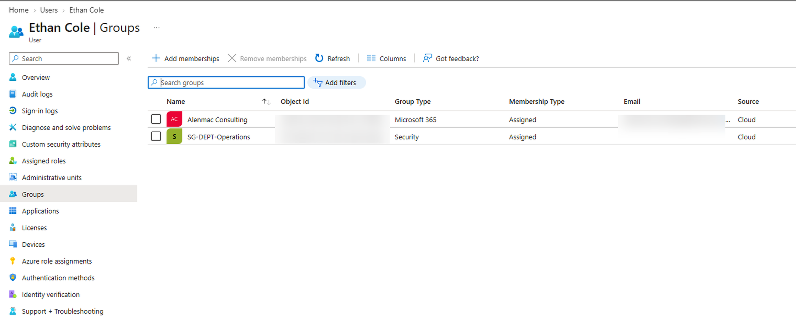
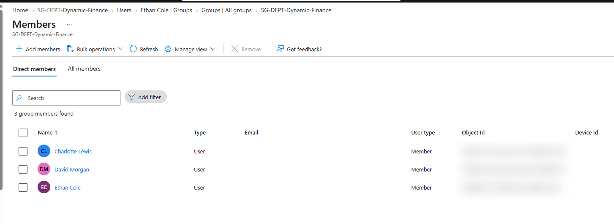
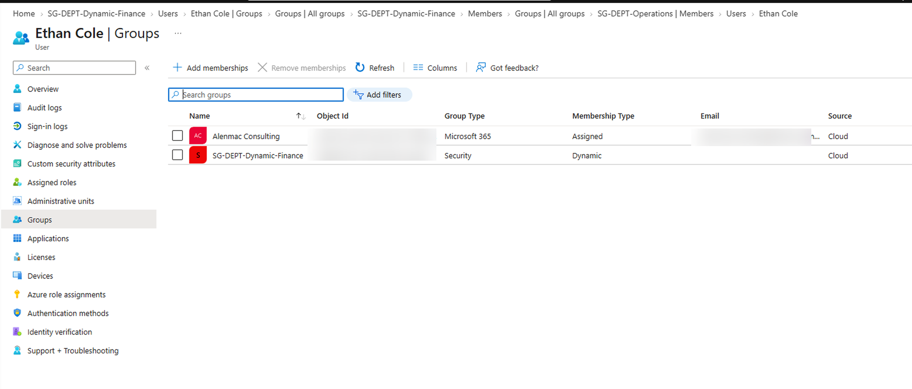
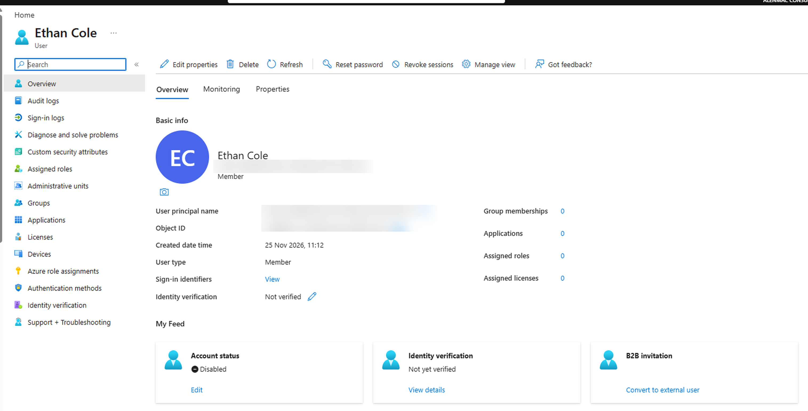
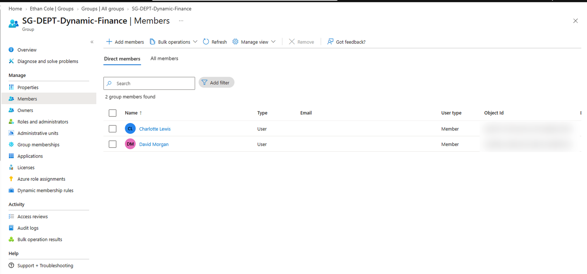

# LAB-005: User Lifecycle Management

## 1. Lab Overview

| Field | Details |
|---|---|
| Lab ID | LAB-005 |
| Title | User Lifecycle Management |
| SC-300 Skill Area | Implement and manage user identities |
| Organisation | Alenmac Consulting (fictional organisation) |
| Status | Completed |

## 2. Business Scenario

Alenmac Consulting requires a consistent approach to managing employee identities throughout their employment lifecycle.

This exercise simulates three common identity management scenarios: an employee joining the organisation, transferring between departments and eventually leaving.

A fictional employee, Ethan Cole, was used to demonstrate the complete lifecycle.

## 3. Objectives

- Provision a new employee identity.
- Configure user profile attributes and group membership.
- Simulate an internal department transfer.
- Demonstrate attribute-based dynamic group membership.
- Disable an employee account during offboarding.
- Revoke active sign-in sessions.
- Remove access through group membership management.

## 4. Implementation

### Scenario 1: Joiner — New Employee

Created a fictional employee account for Ethan Cole.

Initial profile:

| Attribute | Value |
|---|---|
| Display name | Ethan Cole |
| Job title | Operations Analyst |
| Department | Operations |
| User type | Member |
| Account status | Enabled |

Added Ethan to the `SG-DEPT-Operations` security group.

Verified that the account was enabled and the correct departmental group membership was present.

### Scenario 2: Mover — Department Transfer

Simulated an internal transfer from Operations to Finance.

Updated the employee profile:

| Attribute | Previous value | Updated value |
|---|---|---|
| Job title | Operations Analyst | Finance Analyst |
| Department | Operations | Finance |

The Department attribute change triggered the dynamic membership rule configured on `SG-DEPT-Dynamic-Finance`.

Ethan was automatically added to the Finance dynamic group alongside the two existing Finance employees.

The previous `SG-DEPT-Operations` membership was then manually removed.

Verified that Ethan retained the organisation's Microsoft 365 group membership and appeared in the Finance dynamic group.

### Scenario 3: Leaver — Employee Offboarding

Simulated Ethan leaving the organisation.

The following actions were performed:

1. Disabled the employee account in Microsoft Entra ID.
2. Revoked the employee's sign-in sessions.
3. Removed remaining assigned group membership.
4. Changed the Department attribute to `Former Employee`.

After dynamic membership processing completed, Ethan was automatically removed from `SG-DEPT-Dynamic-Finance`.

The user account was retained rather than deleted to preserve the identity record.

## 5. Testing and Results

| Test | Expected result | Outcome |
|---|---|---|
| Create employee account | Account created successfully | Successful |
| Assign departmental group | Operations group membership established | Successful |
| Update department | Department changed to Finance | Successful |
| Dynamic group evaluation | Ethan automatically added to Finance group | Successful |
| Remove previous membership | Operations group membership removed | Successful |
| Disable employee account | Account status changed to Disabled | Successful |
| Revoke sessions | Existing sign-in sessions revoked | Successful |
| Remove assigned membership | Assigned group membership removed | Successful |
| Dynamic group evaluation after departure | Ethan automatically removed from Finance group | Successful |

## 6. Lessons Learned

- Identity management involves more than creating user accounts.
- User attributes can drive automated access management through dynamic groups.
- Department changes can trigger automatic group membership changes.
- Assigned group membership requires separate administrative management.
- Disabling an account and revoking sessions are separate offboarding controls.
- Retaining disabled accounts can preserve identity records for audit and administrative purposes.
- Effective offboarding requires reviewing both assigned and dynamically managed access.

## 7. References

- [Microsoft Entra user management](https://learn.microsoft.com/en-us/entra/identity/users/)
- [Microsoft Entra dynamic groups](https://learn.microsoft.com/en-us/entra/identity/users/groups-dynamic-membership)
- [Revoke user access in Microsoft Entra ID](https://learn.microsoft.com/en-us/entra/identity/users/users-revoke-access)

## 8. Evidence

All screenshots were captured during the practical implementation of the Joiner, Mover and Leaver scenarios.

### Joiner — Employee Provisioning

**Ethan Cole — User profile**

**Departmental group membership**

### Mover — Department Transfer

**Automatic Finance group membership**

**Updated group memberships**

### Leaver — Employee Offboarding

**Disabled employee account**

**Final dynamic Finance group membership**

